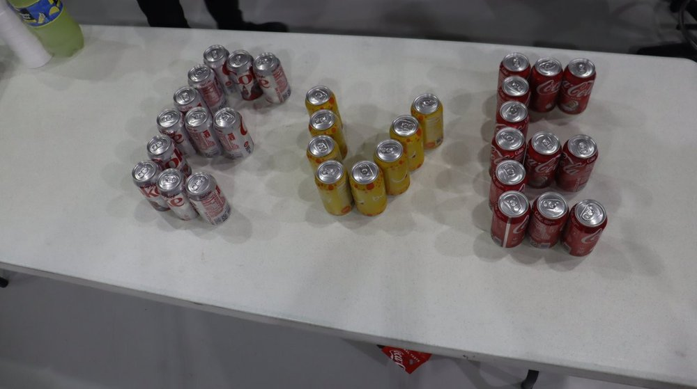

# Launch Updates

The latest updates on the status of the NASA 36.406 solar EUV calibration rocket launch will be shared below. The launch is scheduled for December 11, 2026.

{ style="height: 4rem; width: auto;" }

### 20 November 2026

All of the rocket subsystems for NASA 36.406 have been integrated and we're preparing to do sequence tests in preparation for environmental tests next week.

### 18 November 2026

Pre-Thanksgiving festivities are a go.

The team is at the White Sands Missile Range and has begun preparations for the 36.406 sounding rocket launch.

{ style="width: 18rem; max-width: 100%;" }

### 10 November 2026

Finished loading the truck, ready to ship to WSMR.

{ style="width: 13rem; max-width: 100%;" }

