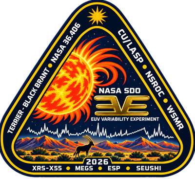
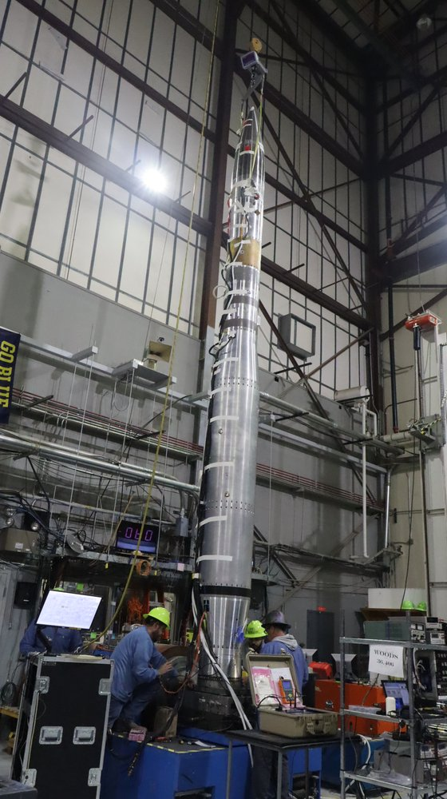
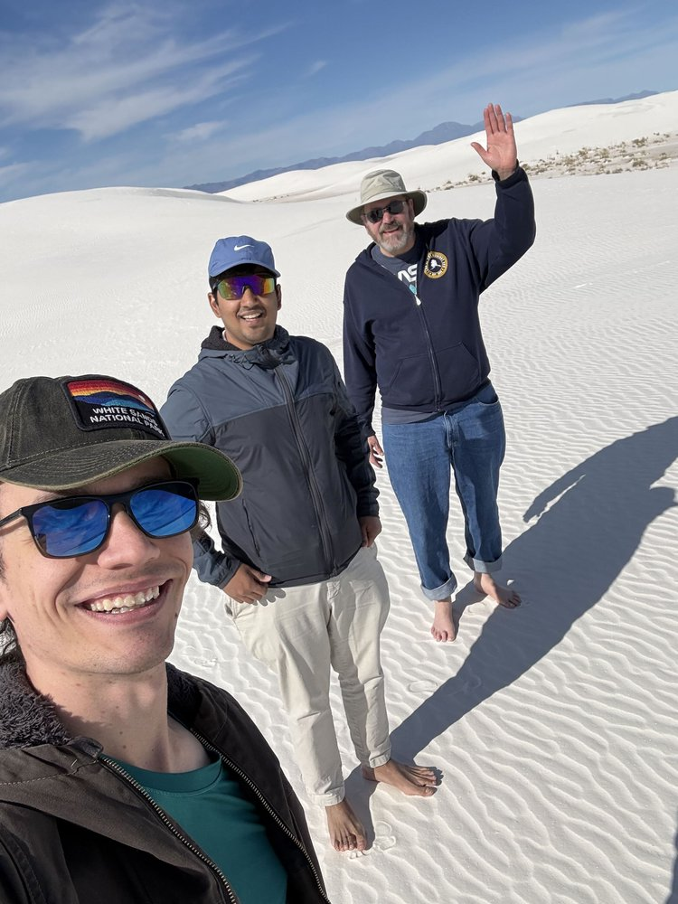
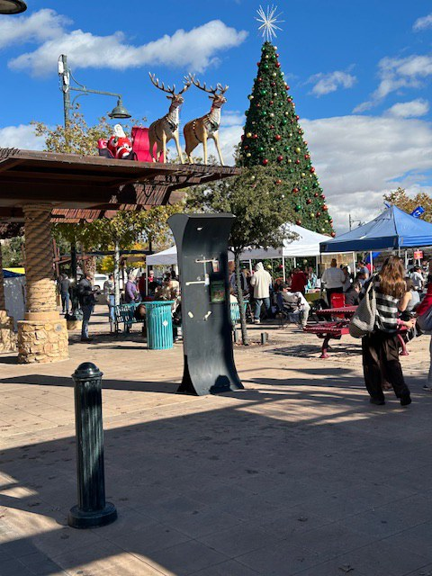
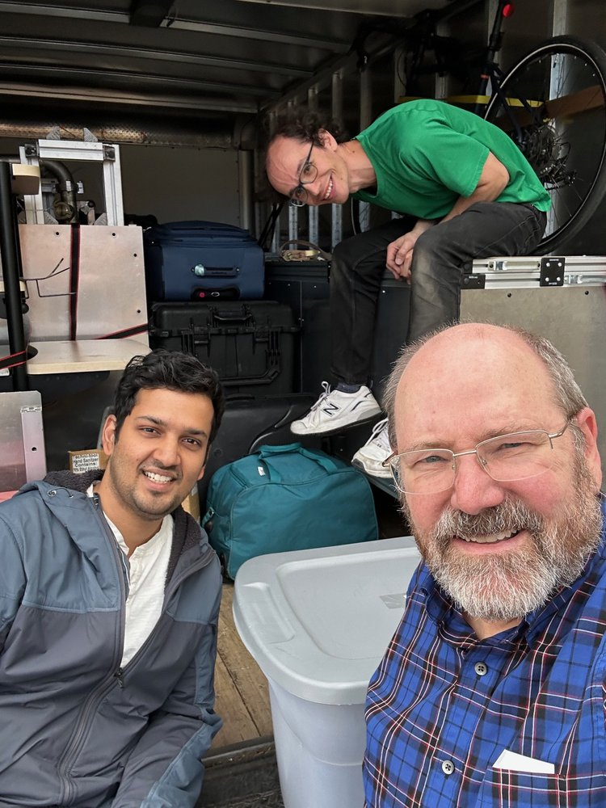

# Launch Updates 36.406

The latest updates on the status of the NASA 36.406 solar EUV calibration rocket launch will be shared below. The launch is scheduled for December 11, 2026.

[{ style="width: 200px; max-width: 100%;" }](img/eve-36406-patch.png){ target="_blank" title="Click to open full size" }

### 26 November 2026

Science team went out for a traditional thanksgiving feast. Unfortunately it was so tasty we forgot to get the picture before it was mostly gone!

[{ style="width: 18rem; max-width: 100%;" }](img/thanksgiving-feast-2026-11-26.jpg){ target="_blank" title="Click to open full size" }

### 25 November 2026

Today was Spin Balance and Mass Properties. Had to use some pretty sizeable lead bricks to balance the payload out, but the team got there!

### 24 November 2026

Post-vibe sequence test went well! Built back up for a successful bend test in the evening.

### 23 November 2026

The rocket went through vibe today. Sequence testing tomorrow but for now all systems appear functional!

[{ style="width: 13rem; max-width: 100%;" }](img/vibe-test-2026-11-23.jpg){ target="_blank" title="Click to open full size" }

### 22 November 2026

Science team took a trip to check out potential landing sites.

[{ style="width: 13rem; max-width: 100%;" }](img/landing-sites-2026-11-22.jpg){ target="_blank" title="Click to open full size" }

### 21 November 2026

Santa has arrived early in Las Cruces! Perhaps stocking up on green chili before his big journey?

[{ style="width: 13rem; max-width: 100%;" }](img/holidays-las-cruces-2026-11-21.jpg){ target="_blank" title="Click to open full size" }

### 20 November 2026

All of the rocket subsystems for NASA 36.406 have been integrated, sequence tests completed with minimal notes, GPS rollout completed, payload is back in I-lab and will be pumping down through the weekend in preparation for environmental tests next week.

### 18 November 2026

Pre-Thanksgiving festivities are a go.

The team is at the White Sands Missile Range and has begun preparations for the 36.406 sounding rocket launch.

[{ style="width: 18rem; max-width: 100%;" }](img/pre-thanksgiving-2026-11-18.jpg){ target="_blank" title="Click to open full size" }

### 10 November 2026

Finished loading the truck, ready to ship to WSMR.

[{ style="width: 13rem; max-width: 100%;" }](img/truck-loading-2026-11-10.jpg){ target="_blank" title="Click to open full size" }
